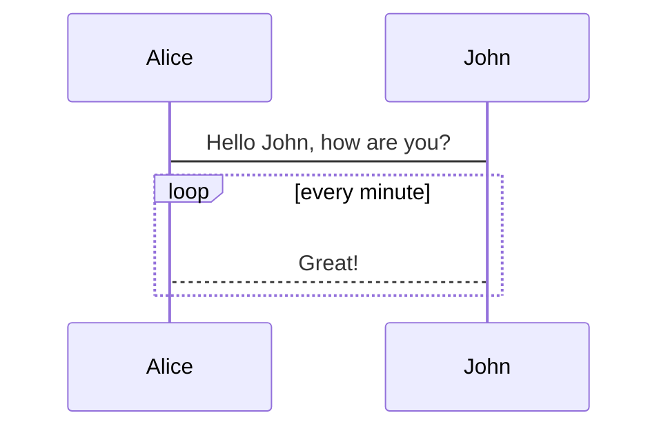

> :::info
> This article was automatically translated by Google "Gemini". The author does not guarantee its accuracy or wording.
> :::

> :::info
> This article was migrated from the old blog archive.
> :::


# Preface

The <ruby><font  color="lightblue"><del>Throwback Series</del></font><rp>(</rp><rt><font  color="red">Slacking at Work</font></rt><rp>)</rp></ruby> series is back again... Since I had nothing better to do, I decided to dig into the current NexT theme to see if there's anything fun to play with...


<!--truncate-->

# Modifications

## Codeblock - Code Fence Effect Adjustments

### Config Changes

```json
codeblock:
  # Code Highlight theme
  # All available themes: https://theme-next.js.org/highlight/
  theme:
    light: default
    dark: tomorrow-night
  prism:
    light: prism
    dark: prism-dark
  # Add copy button on codeblock
  copy_button:
    enable: true
    # Available values: default | flat | mac
    style: mac
```

### Preview

#### Using Default/Flat Style


#### Using Mac Style


Looks like Mac style is a bit flashier.....

## Tag Effect Adjustments

### Config Changes

```bash
# ---------------------------------------------------------------
# Tags Settings
# See: https://theme-next.js.org/docs/tag-plugins/
# ---------------------------------------------------------------

# Mermaid tag
mermaid:
  enable: ture
  # Available themes: default | dark | forest | neutral
  theme:
    light: default
    dark: dark
```

### Preview

#### Enabling Mermaid Diagrams

##### Markdown Code

```bash
#```mermaid                                 #這個要用code fence語法表示
sequenceDiagram
    Alice->John: Hello John, how are you?
    loop every minute
        John-->Alice: Great!
    end
#```
```

##### Actual Result



#### Different Styles - default

##### Light theme


##### Dark theme


#### Different Styles - dark

##### Light theme


##### Dark theme


#### Different Styles - forest

##### Light theme


##### Dark theme


#### Different Styles - neutral

##### Light theme


##### Dark theme


I later discovered it might be an issue with my Dark theme.js—when the Mermaid light & dark themes are set differently, it only renders the light theme style.. so in the end I set both to the dark theme.

# Conclusion...

Just having way too much free time... honestly I barely even use Mermaid for drawing diagrams anyway...
