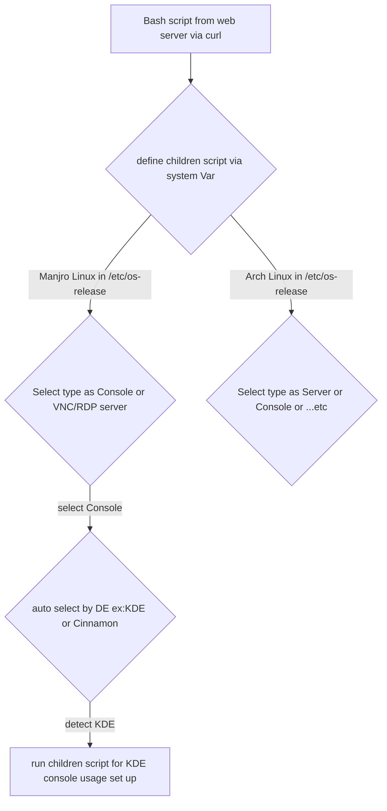

> :::info
> This article was automatically translated by Google "Gemini". The author does not guarantee its accuracy or wording.
> :::

> :::info
> This article was migrated from an old site archive.
> :::

# Preface

It's been a long time since I updated my Blog. Although the main reason is that I'm lazy, that doesn't mean I haven't been doing anything...   

<!--truncate-->

# Rambling Corner

I haven't updated my Blog recently, but quite a few things have happened.

* Had a great trip around Southeast Asia - Malaysia & Thailand

* Writing a Universal script

These two things are probably the most worth writing about from late September up until today.

# Southeast Asia

Nothing special really—I just went to Malaysia and Thailand on a business trip.

## Malaysia

Honestly, even though I try not to have prejudices, I did realize I had some bias toward Southeast Asia. I originally thought Malaysia's infrastructure and such would be way behind Taiwan's, only to go there and realize the clown was me...

Malaysia has pretty solid infrastructure and gives off an overall laid-back yet prosperous vibe, and their e-payment adoption is streets ahead of Taiwan.... Seriously makes you feel like if Taiwan doesn't step up its game, it's going to fall way behind...

## Thailand

My impression of Thailand was still stuck back in 2014. On this trip I noticed their digitalization is actually pretty decent... Also maybe because I stayed in Pattaya this time, it felt less rural than my previous time in Phetchaburi.

Though since you can easily buy stuff from PChome Thai in Taiwan nowadays, I didn't really feel the need to bring back a ton of local souvenirs...

# Universal Script

Strictly speaking, this is the thing really worth writing about. It's basically an expanded version of the `Arch Linux Automatic Install Script` I wrote before, aiming to cram in all the Unix-like OSes I use myself.

Currently (planned) scope covered:

* Manjaro Linux with Desktop for Console and VNC/RDP server
  
  * KDE (90% complete)
  
  * Xfce (0% complete)
  
  * Gnome (0% complete) - considering whether to drop this
  
  * Cinnamon (0% complete)

* Fedora Linux with Desktop for Console and VNC/RDP server (0%)

* Linux Mint with Desktop for Console and VNC/RDP server (0%) - considering whether to keep

* Arch Linux (0%)

* Photon OS (0%)

* FreeBSD (0%)

## Concept and Approach

Basically, it's about writing an auto-detection script first that routes to the corresponding child script for configuration or installation.

That diagram roughly captures the logic above.

Right now the progress is basically that I've finished writing that initial selector script, and the core Manjaro part (mainly KDE) is done. The other DE sections will need fine-tuning after I actually install those editions.

## Other Takeaways

### Script - if condition

This is probably the feature I used most while writing the script recently.. definitely spent quite some time studying how to write the conditions.

## Script - source other script

I introduced this feature pretty late in the process, and it's awesome... Basically, just like in other programming languages, you can split out modules you've already written (or highly repetitive code) into separate files and load them using `source`. Combined with `function` features I learned later, you can load everything first and only call the function when needed, and even pass additional arguments when calling it.

## Script - function

This started out as a fancier way to write scripts—originally intended for cosmetic stuff like banners or menus—but later I found you can load all kinds of random things through functions... so I started going wild with it....

## VNC/RDP

The biggest discovery is that these two things can actually coexist and run together.... just install what needs to be installed and you're good to go....

In a Manjaro environment, you need `tigervnc` for the VNC server and `xrdp` for the RDP server.

One caveat though: when connecting to `xrdp`, you must not pre-fill the username by default—it'll cause issues. You need to go in blank and type it afterward.

## DE review

Previously I used Manjaro XFCE for VNC and Manjaro KDE for console. However, today I found GNOME really doesn't suit my taste, so I took a cue from Linux Mint and tried Cinnamon and found it's actually pretty okay—especially since you can back up the entire DE's settings with `dconf dump /org/cinnamon > file.name`... I'm so happy about that....

Maybe later I'll try switching my main DE from KDE over to Cinnamon, though since Manjaro Cinnamon isn't an Official edition, its Chinese localization and performance tuning aren't super polished... there's a good chance it'll take a lot of time to fine-tune....

# Conclusion

I've actually accumulated quite a bit of material to write about during this period... but honestly out of sheer laziness I simplified it again and again... Once it's finished later, I'll break it apart and write it into the Wiki.