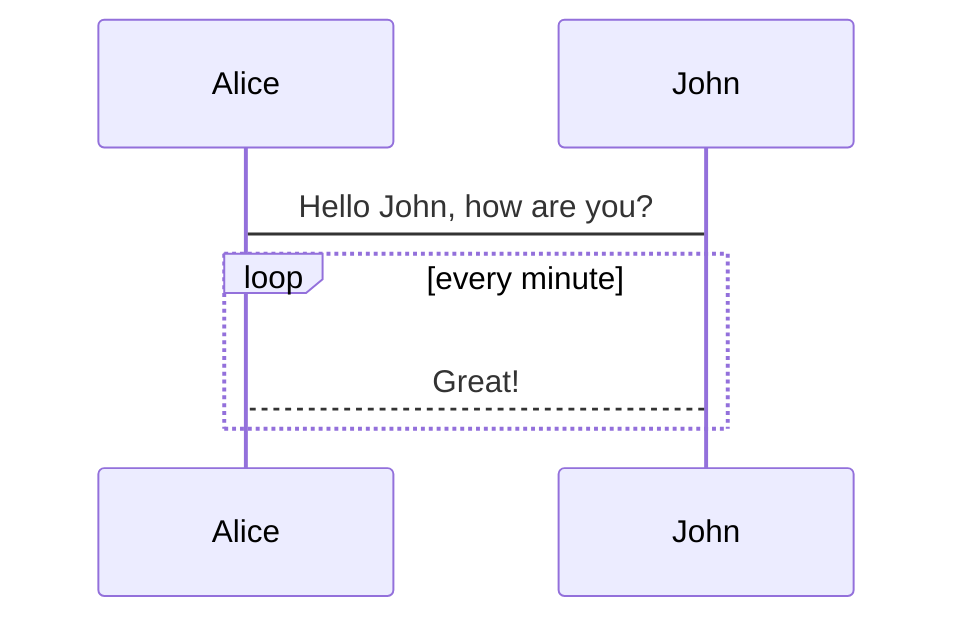

> :::info
> この記事は Google「Gemini」によって自動翻訳されたものであり、筆者は内容の正確性および表現について保証いたしません。
> :::

> :::info
> この記事は旧サイトのアーカイブから転載されたものです。
> :::


# はじめに

<ruby><font  color="lightblue"><del>振り返りシリーズ</del></font><rp>(</rp><rt><font  color="red">給料泥棒</font></rt><rp>)</rp></ruby>シリーズがまたやってきました……何をしていいかわからなかったので、いっそ今の NexT テーマを掘り下げて面白い機能がないか調べてみることにしました……。


<!--truncate-->

# 変更内容

## Codeblock - Code fence 表示効果の調整

### 設定変更箇所

```json
codeblock:
  # Code Highlight theme
  # All available themes: https://theme-next.js.org/highlight/
  theme:
    light: default
    dark: tomorrow-night
  prism:
    light: prism
    dark: prism-dark
  # Add copy button on codeblock
  copy_button:
    enable: true
    # Available values: default | flat | mac
    style: mac
```

### 表示プレビュー

#### Default / Flat を使用した場合の表示は以下の通り


#### Mac を使用した場合の表示は以下の通り


やっぱり Mac スタイルの方が見た目がちょっとオシャレですね……。

## Tag 表示効果の調整

### 設定変更箇所

```bash
# ---------------------------------------------------------------
# Tags Settings
# See: https://theme-next.js.org/docs/tag-plugins/
# ---------------------------------------------------------------

# Mermaid tag
mermaid:
  enable: ture
  # Available themes: default | dark | forest | neutral
  theme:
    light: default
    dark: dark
```

### 表示プレビュー

#### Mermaid 描画の有効化

##### Markdown コード

```bash
#```mermaid                                 #這個要用code fence語法表示
sequenceDiagram
    Alice->John: Hello John, how are you?
    loop every minute
        John-->Alice: Great!
    end
#```
```

##### 実際の表示効果



#### 各スタイル別 - default

##### Light テーマ


##### Dark テーマ


#### 各スタイル別 - dark

##### Light テーマ


##### Dark テーマ


#### 各スタイル別 - forest

##### Light テーマ


##### Dark テーマ


#### 各スタイル別 - neutral

##### Light テーマ


##### Dark テーマ


その後わかったのですが、私の Dark theme.js に問題があるようで、Mermaid の light テーマと dark テーマを別の設定にすると light テーマのスタイルだけがレンダリングされてしまう状態でした……なので最終的には両方同じ dark テーマを採用することにしました。

# まとめ……

要するに暇を持て余していただけです……実際には Mermaid で図を描くこともほとんどないんですけどね……。
