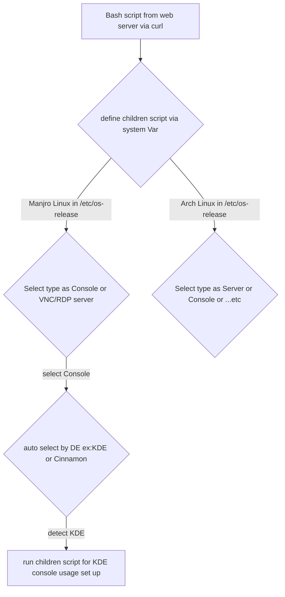

> :::info
> この記事は Google「Gemini」によって自動翻訳されたものであり、筆者は内容の正確性および表現について保証いたしません。
> :::

> :::info
> この記事は旧サイトのアーカイブから転載されたものです。
> :::

# はじめに

長い間ブログを更新していませんでした。主な理由は怠けていただけなのですが、かといって何もしていなかったわけではありません……

<!--truncate-->

# 雑談コーナー

最近はブログこそ更新していませんでしたが、いろいろと出来事がありました。

* 東南アジアで羽を伸ばしてきた - マレーシア & タイ

* Universal script の執筆

この 2 つが、9 月下旬から今日にかけて比較的書く価値のある出来事かなと思います。

# 東南アジア

といっても大した話ではなく、出張という名目でマレーシアとタイへ行ってきただけです。

## マレーシア

正直なところ、自分では偏見を持たないように心がけていたつもりでしたが、やはり東南アジアに対する先入観があったことに気づかされました。当初はマレーシアのインフラなどは台湾よりだいぶ遅れているだろうと思っていたのですが、現地に行ってみるとピエロだったのは自分の方でした……

マレーシアはかなり整ったインフラを持っており、全体としてゆったりしていながらも貧しさを感じさせない雰囲気でした。さらに電子決済は台湾より何歩も先を進んでいて……正直、台湾もこのまま進歩しなければ大きく引き離されてしまうのではないかと感じるほどでした……

## タイ

タイに対する私の印象は 2014 年のまま止まっていたのですが、今回行ってみて、さまざまな電子化がかなりうまく進んでいると感じました……また、今回滞在したのがパタヤ（Pattaya）だったこともあり、以前ペッチャブリーにいた頃のような田舎っぽさはあまり感じませんでした。

ただ、今は台湾からでも PChome Thai で手軽に現地のものが買えるので、以前ほどたくさんお土産を買って帰る必要を感じなくなりましたね……

# Universal Script

実のところ、本当に書く価値があるのはこちらです。これは以前私が書いた `Arch Linux Automatic Install Script` の拡大版で、自分が使う Unix 系 OS をすべて詰め込んでしまおうという試みです。

現在（予定）カバーしている範囲は以下の通りです。

* Manjaro Linux with Desktop for Console and VNC/RDP server

  * KDE（90% 完了）

  * Xfce（0% 完了）

  * Gnome（0% 完了） - 外すかどうか検討中

  * Cinnamon（0% 完了）

* Fedora Linux with Desktop for Console and VNC/RDP server（0%）

* Linux Mint with Desktop for Console and VNC/RDP server（0%） - 残すかどうか検討中

* Arch Linux（0%）

* Photon OS（0%）

* FreeBSD（0%）

## コンセプトと実装方法

要するに、最初に自動判別用のスクリプトを書き、そこから対応するサブスクリプトへ誘導して設定やインストールを実行させる仕組みです。

おおよそ上の図のようなロジックになっています。

現在の進捗としては、最初の振り分け用スクリプトは書き終えており、Manjaro のコア部分（主に KDE 向け）も完成しています。その他の DE の内容については、該当バージョンをインストールした上でさらに微調整（fine tune）していく必要があります。

## その他の収穫

### Script - if condition

これは最近スクリプトを書く中で最もよく使った機能だと思います……条件式の書き方を調べるのにかなり時間を使いました。

## Script - source other script

この機能はかなり後半になってから導入したのですが、非常に素晴らしいです……基本的には他のプログラミング言語と同じように、あらかじめ書いたモジュール（あるいは重複の多いコード）を別ファイルに切り出し、`source` で読み込んでおくことができます。後から覚えた `function` 機能と組み合わせれば、先にロードしておいて必要な時にその関数を呼び出すといった使い方ができますし、呼び出す際に別の変数を渡すことすら可能です。

## Script - function

これは少し凝ったスクリプトの書き方で、もともとはバナーやメニューなどの装飾目的で使うつもりだったのですが、後からあれこれ何でも関数として組み込めることが分かり……結果として好き放題にやり始めました……

## VNC/RDP

一番の発見は、なんとこの 2 つが共存して同時に動かせるということでした……必要なものをインストールするだけで普通に動きます……

Manjaro 環境では、VNC サーバーに tigervnc、RDP サーバーに xrdp が必要です。

ただし一点注意が必要で、xrdp に接続する際はデフォルトでユーザー名を入力した状態にしておくと問題が起きるため、空欄のまま接続してから入力する必要があります。

## DE review

以前は VNC 用に Manjaro XFCE、コンソール用には Manjaro KDE を使っていたのですが、今日になって GNOME は自分の好みに合わないことに気づきました。そこで Linux Mint を参考に Cinnamon を試してみたところ、意外と悪くないことが分かりました。特に `dconf dump /org/cinnamon > file.name` の形式で DE 全体の設定をバックアップできるのが本当に嬉しいです……

今後はメインの DE を KDE から Cinnamon に乗り換えてみるかもしれません。ただ、Manjaro Cinnamon は公式エディションではないため、中国語化やパフォーマンス調整があまり行き届いておらず……微調整にかなりの時間を費やすことになりそうです……

# おわりに

この期間に書けそうなネタはいろいろ溜まっていたのですが……本当に面倒くさがりなので簡略化に簡略化を重ねてしまいました……一通り完成したら、あらためて分割して Wiki の方に書きまとめようと思います……
